# 6부. 리더 다운과 리더 에포크

## 1. 리더 다운과 데이터 정합성 문제
- 복제는 FetchRequest polling을 통해 각 ISR 간 비동기 동기화
- 따라서, 리더가 다운되었을 때 ISR간 상태 정합성이 불일치할 수 있음

ex)
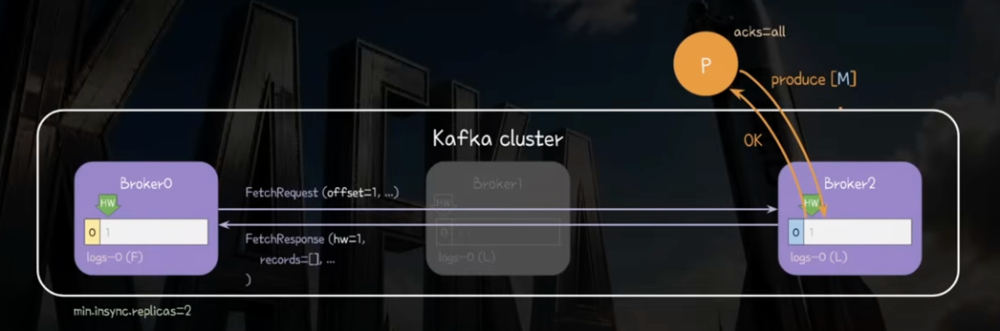
- 리더에 쓰고 -> Broker 0에 복제 -> 리더 다운
- Broker2에 쓰고  -> Broker 0이 FetchRequest(offset = 1)
- Broker2는 offset=1 보고 HW1로 옮김 -> Broker 0도 HW=1로 옮김
-> 각 HW 위치만 보기 때문에 서로 다른 데이터를 가지고 있어도 제대로 복제된 것처럼 OK 

## 2. 정합성 문제 해결(v0.11.0 이전) : HW 부터 그 이후의 레코드를 버리자!
- HW 이전까지는 모두 정직하게 복제된 레코드일거야 -> 그럼 리더 변경, 리더 다운 시에 HW까지만 보존하자
- 레플리카가 재시작 or 복구되었을 때 -> HW부터 이후 레코드들을 모두 삭제
- 팔로워 레플리카가 리더가 다른 리더로 바뀌었을 때 해당 팔로워는 HW 이후 레코드 삭제
=> 그럼에도 내용이 아닌 offset 위치만 본다는 한계가 있음

### 2-1) 해결 케이스
- Broker1 Leader가 다운되고 Broker2가 새로운 리더가 된 상황
  **- Broker0은 리더가 바뀐것을 인지하고 HW 이상의 레코드를 모두 제거** 
  - 불일치하는 데이터를 초기화하여 데이터 정합성 해결
  - 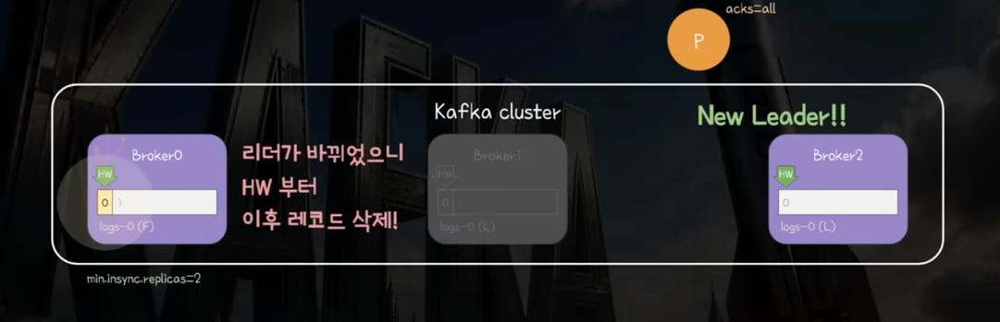
  - 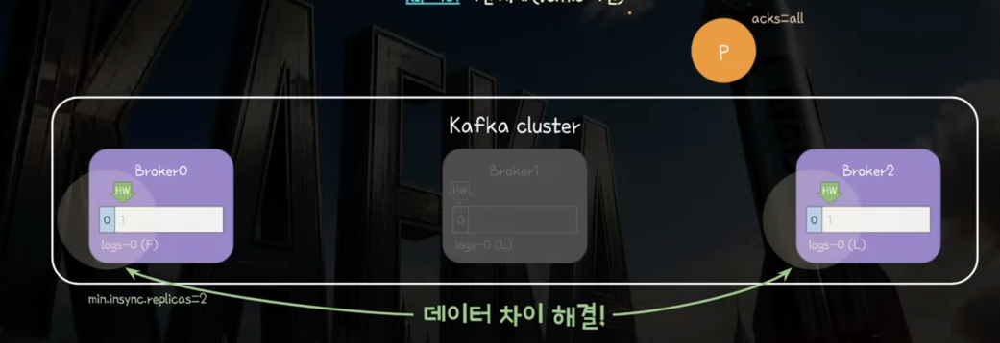

  **- Broker1이 다시 복구된 케이스 -> HW 이후의 값 모두 제거**
  - 

### 2-2) 예외 케이스1. 처리된 메시지의 유실
1) 모두 완전히 LEO 상으로 복제가 되었으나 아직 HW상에 싱크가 맞지 않음
  - Broker0은 HW1, Broker1은 HW 2
  - 다음 Broker0의 FetchRequest에서 HW 동기화 기대
  - 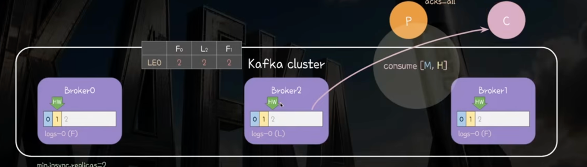

2) Consumer가 Consume 완료
3) Broker0의 빠른 재시작으로 인한 부정합 + Leader Down
   - HW 이후의 것들 모두 날림 -> HW(1)이상의 것들 날림
   - 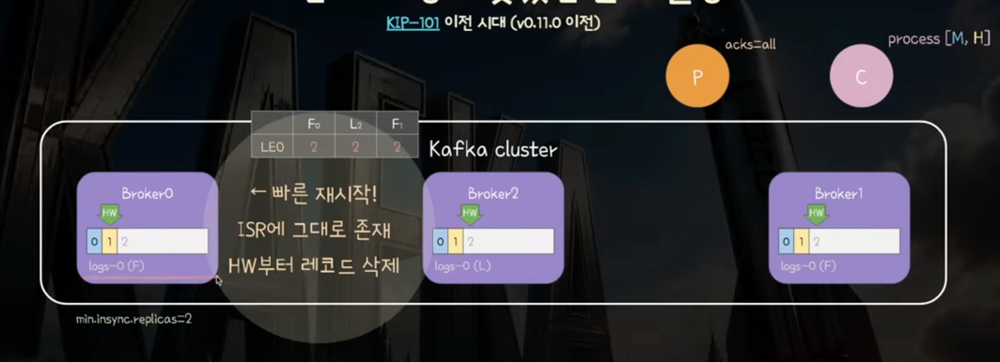
   - 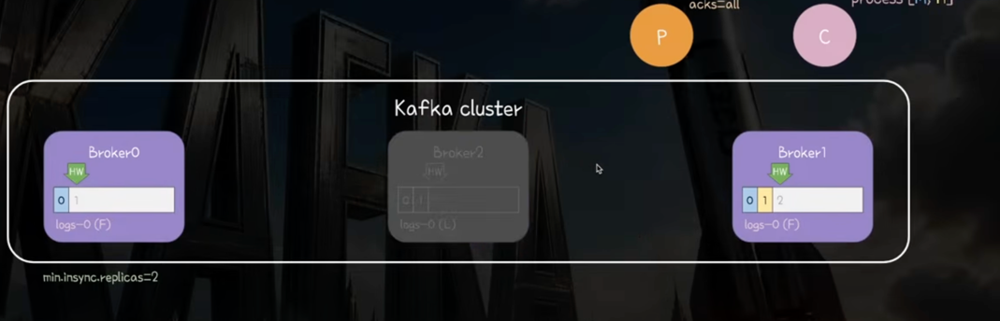

4) Broker 0이 새로운 리더가 됨
   - Broker1이 리더가 바뀌었으니 HW(2)부터 레코드 삭제 -> 영향 없음
   - 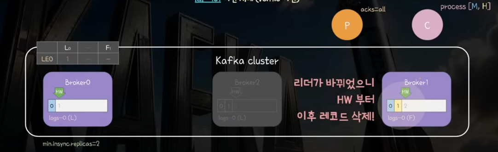
5) Broker1 -> Broker0에게 offset=2로 요청 -> OFF_SET_OUT_OF_RANGE 예외 발생
   - 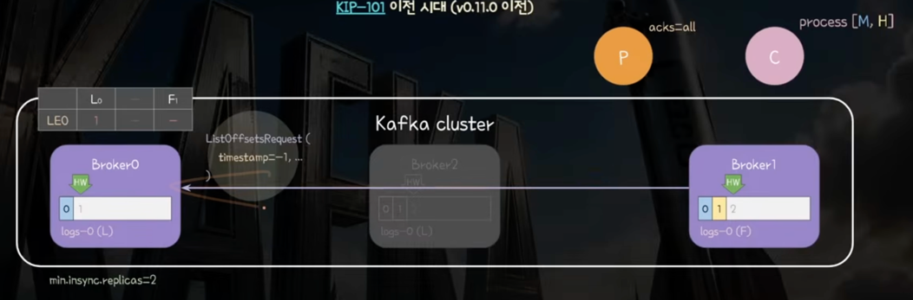
6) ListOffsetsRequest로 Leader의 LEO를 알아내어 동기화
   - Broker0 <- ListtOffsetRequest <- Broker1
   - Broker0 -> offset=1 -> Broker1 (아, 데이터 0까지가 진실원이구나)
   - Broker가 1이상의 것들을 삭제함 + HW를 Leader와 같은 값으로 조정
   - 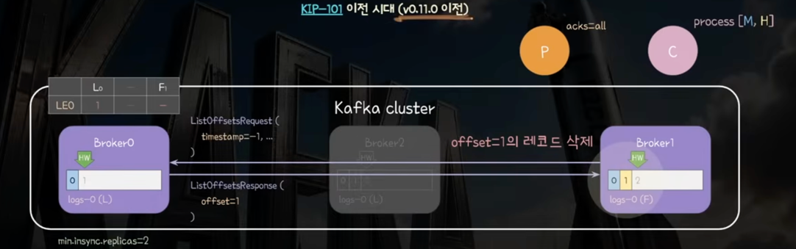
7) 이미 처리된 값이 아예 유실됨
   - 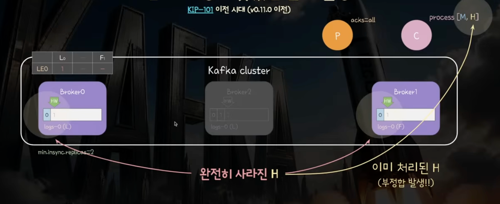

### 2-3) 예외 케이스2. offset만 보아서 다른 데이터 보유 가능
- 같은 HW를 가진 상태에서의 다운된 레플리카의 복구 상황 
- -> 복구된 레플리카의 HW 이후 삭제 정리(영향 없음) 
- -> 같은 HW라 다른 데이터를 가지고 있어도 ISR 복구됨
- 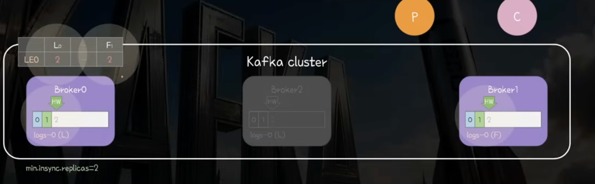
- 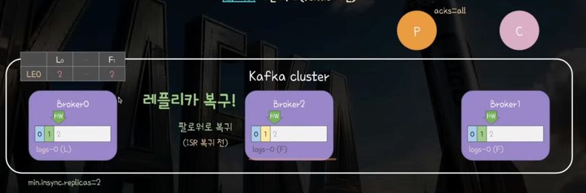
- 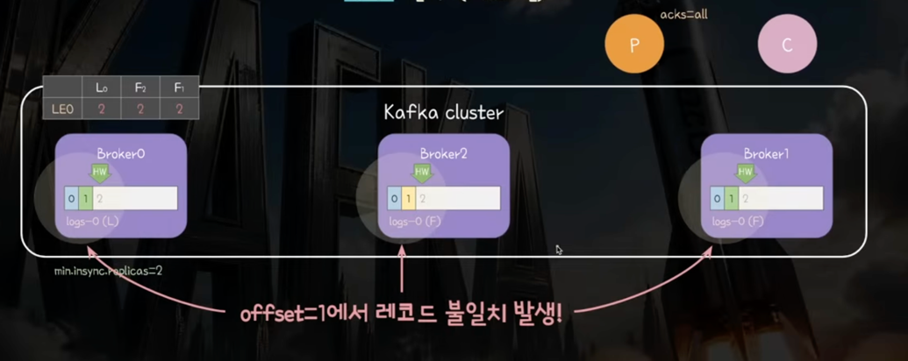

# 3. Leader Epoch

- 리더 에포크 : 32bit 정수
- 리더가 바뀔 때마다 1씩 증가함
- 팔로워는 재시작 or 복구/ 리더 변경 시 리더와 로그 싱크 여부 확인(OffsetsForLeaderEpoch 호출)
  - 즉 내가 가진 구세대에서 몇번째까지를 유지해야할지를 Leader 기준으로 결정
- 각 파티션 단위로 리더 에포크 정보 관리(leader-epoch-checkpoint 파일)
  - epoch - startOffset : 해당 epoch 시대에 시작한 LEO

## 3-1) 데이터 차이 발생하는 케이스 => 해결
- Broker1 Leader Down -> Broker2가 리더로! 
- Broker2의 epoch++ -> 이때 시작한 Leo는 0
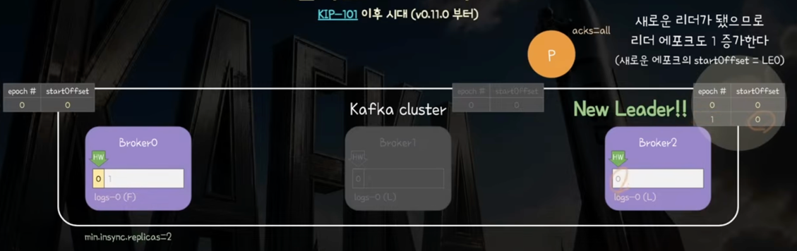

- 팔로워는 리더에게 현재 리더 epoch의 마지막 오프셋을 알려달라고 요청
  - OffsetForLeaderEachRequest(leader_epoch=0) -> 0번 에포크의 마지막 레코드는? == 1번 epoch 시작시점
- 리더는 해당 세대의 마지막으로 동기화된 레코드 LEO를 알려줌
  - 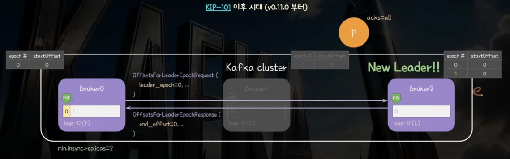
- 해당 LEO부터 전체 삭제 -> 즉, 같은 세대에 동기화되었던 최대 번호를 알아내고 다른 세대부터는 삭제
- Leader가 FetchResponse로 응답하는 record 안에 Leader epoch 정보가 담겨 있어 ISR이 epoch 정보 동기화
  - 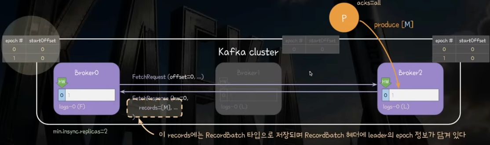

- 레플리카가 복구됨 -> 모두 offset=1로 같은 상황 but, epoch가 다름
1) Broker1(Follower) -> Broker2(Leader) : 내가 가진 기억 세대의 마지막 LEO 주세요(OffsetsForLeaderEpoch)
2) Broker1(Follower) <- Broker2(Leader) : 0세대는 0번 이전까지만 보유하고 다 버릴 것 
3) Broker1이 0을 포함한 데이터 모두 버림
   - 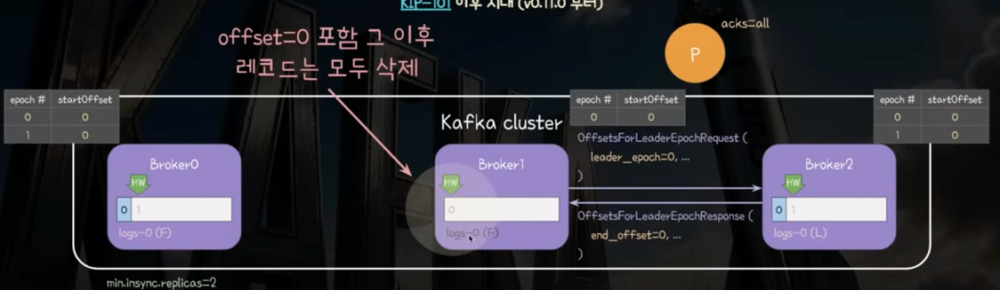
4) Broker1(Follower) -> Broker2(Leader) : FetchRequest(offset=0)
5) Broker1(Follower) <- Broker2(Leader) : FetchResponse(record[0]) 
6) Broker1 : epoch 갱신 -> epoch - startOffset (1-0) -> ISR 복귀!
   - 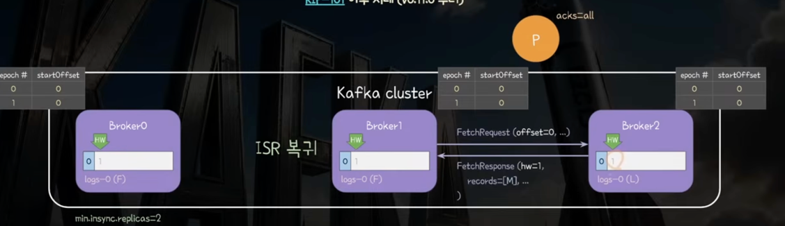

## 3-2) 메시지 유실 상황 : 빠른 재시작으로 데이터 날아가고 리더 다운으로 데이터 동기화가 느린쪽이 리더된 상황
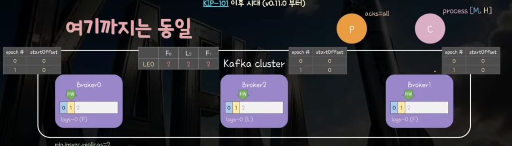

- Broker0이 빠른 재시작 함(HW 이상 값 날리지 않음) -> Broker2 리더 다운 -> Broker0리더됨
- 새로운 리더(Broker0) 이므로 epoch++, LEO 기록 (1-0) -> (2-2)
- 자기 자신의 LEO는 아는데 다른 Follower LEO는 모르는 상태
- 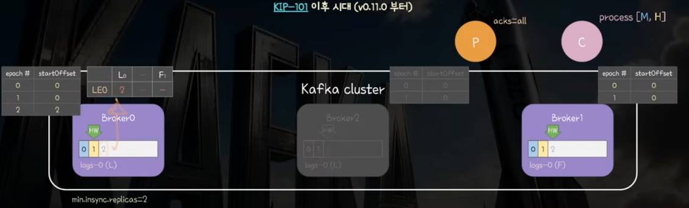 

- Broker0(L) <- Broker1(F) : 1번 epoch 어디까지 가능?
- Broker0(L) -> Broker1(F) : 1번 epoch는 offset=2까지 받았음
- Broker1(F) : offset=2이후 삭제(영향 없음)
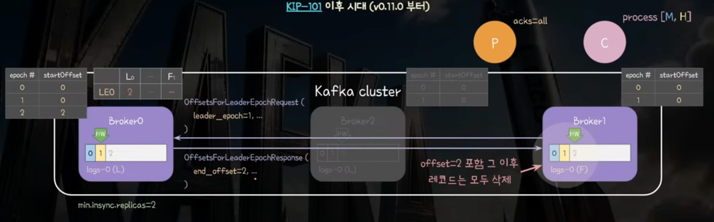

- Broker0(L) <- Broker1(F) : FetchRequest(offset=2)
- Broker0(L) : Follower LEO 2로 갱신 -> HW=2로 미루기
- Broker0(L) -> Broker1(F) : FetchResponse(HW=2) -> record로 epoch 앎
- 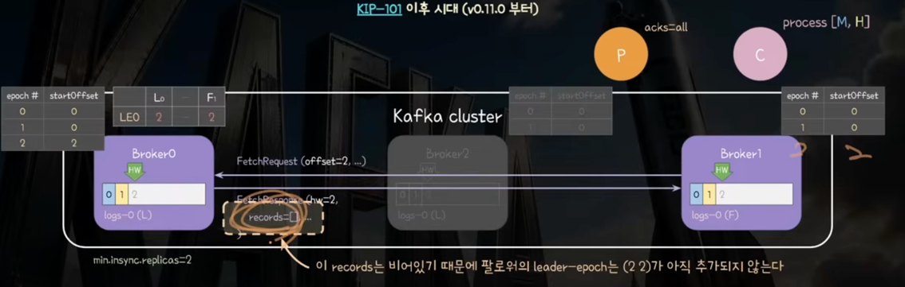

## 3-3) 레플리카 복구 시 offset은 같은데 내용이 달라질 경우 -> 같은 데이터 보장
- 다운되었었던 Broker2 복구 -> epoch 1번의 마지막 세대 알려줘 -> L(Broker0)
- Broker2 offset=2부터 날리자 <- epoch 1세대 offset=2 <- L(Broker0)
- 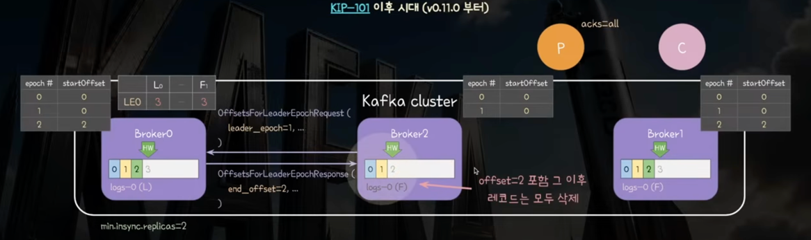

- 이후의 FetchRequest & Response로 다시 싱크 맞춰주고 epoch 정보도 공유
- 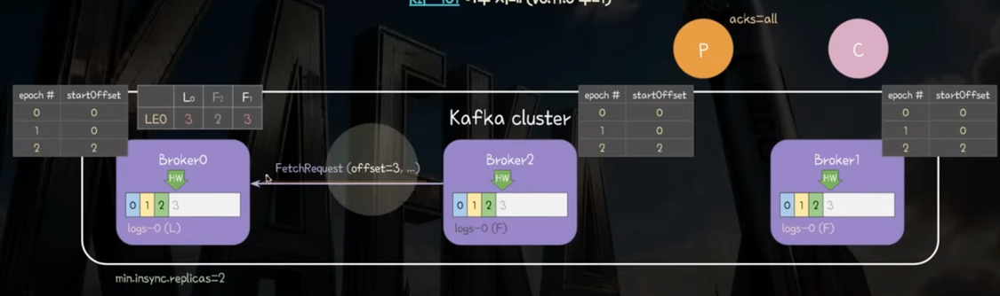

- 복구된 Follower의 FetchRequest offset이 Leader HW랑 같게 되었을 때 -> ISR 복구
- 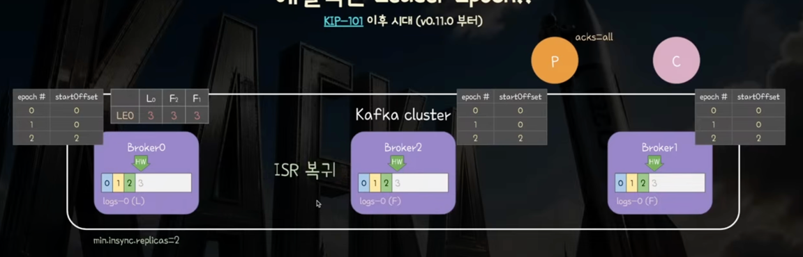
- 

