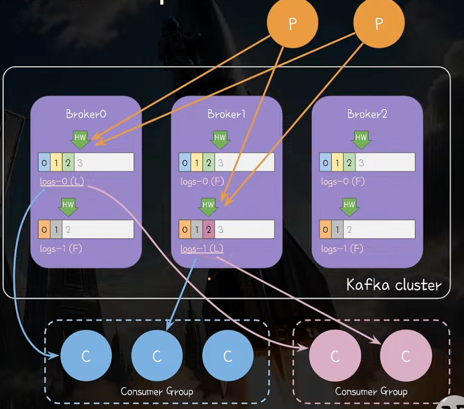
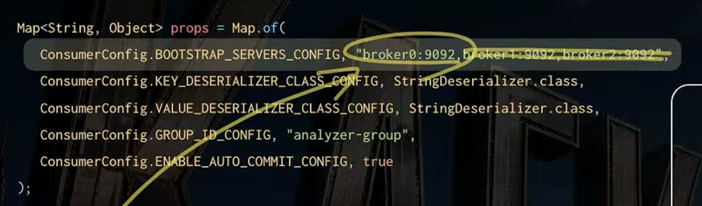
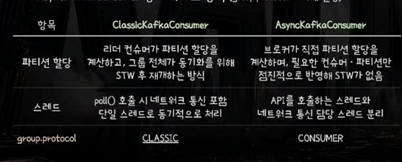
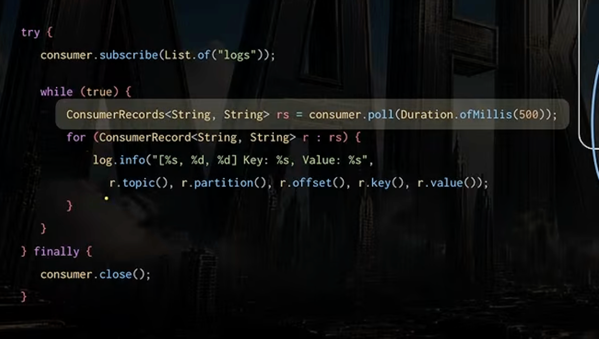
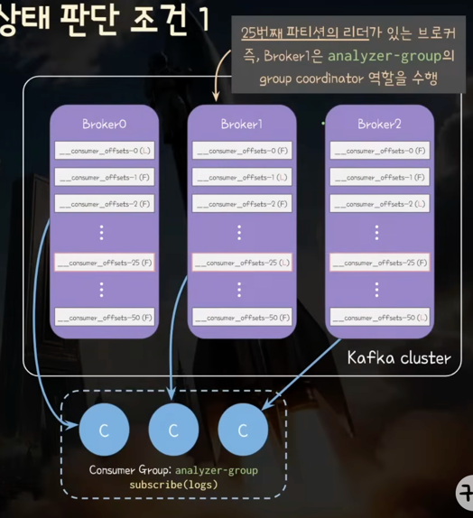
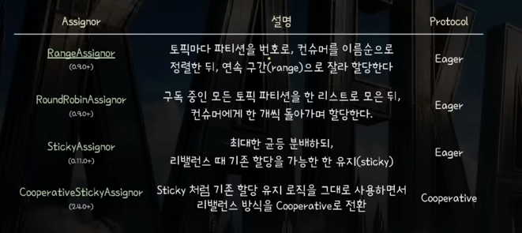
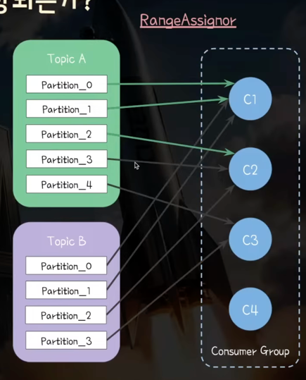
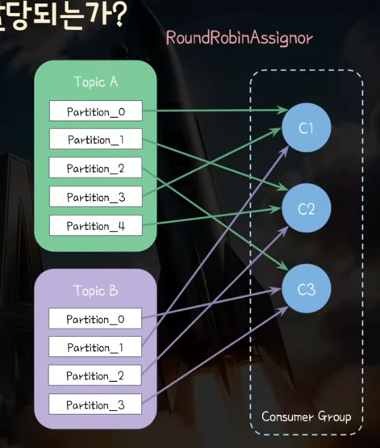
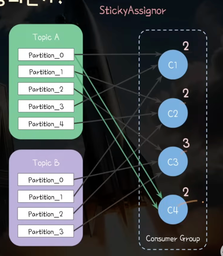

# Consumer 기초

## Consumer & Consumer Group 기초
- Consumer : 카프카 토픽으로부터 레코드 읽어와 처리
- Consumer Group : 같은 Consumer group에 속하는 consumer들은 토픽의 partition을 나눠 구독(subscribe)
- 같은 Consumer Group 내에서는 두 개 이상의 Consumer가 하나의 파티션을 컨슘할 수 없다(순서 보장, Offset 관리 편의를 위해)
- 서로 다른 Consumer Group은 독립적으로 토픽 consume -> Consumer Group 별로 파티션 offset이 관리됨

- ex) logs 토픽(2 partition)을 구독한 Consumer Group의 구성원이 1개일 때 -> 1 consumer X 2 partition으로
ex) Consumer Group에 Consumer 1개 더 추가 -> 2 partition X 2 Consumer -> Rebalancing을 통해 파티션과 소비자가 1:1
ex) Consumer Group에 Consumer 1개 더 추가 -> 2 partition X 3 Consumer -> 1개의 Consumer는 놀게 됨
-> Why? : 1개의 파티션을 두개의 소비자가 소비하게 된다면 각 소비자 처리를 소비자끼리 알아야 하므로 순서보장의 문제가 있을 수 있음

## 설정 예시


- BOOTSTRAP_SERVERS_CONFIG : 브로커 중 하나만 설정해도 접속해서 몯느 브로커 목록 & 파티션 정보 알 수 있음 -> 2-3개 이상의 브로커가 안전
- DESERIALIZER_CLASS_CONFIG : 소비자는 Bytes -> Object로 역직렬화(Deserialize) 도구를 지정
- GROUP_ID_CONFIG : consumer group 소속 지정 -> 파티션 분배를 자동으로 하려면 groupId 지정 필요
- ENABLE_AUTO_COMMIT : group coordinator가 있는 브로커로 commit 요청을 자동으로 함
  - consumer commit : 파티션의 어느 offset부터 이어 consume하면 되는지 내부 토픽(__consumer__offsets - 파티션 50갸)에 기록함
  - group coordinator는 내부 토픽(__consumer_offsets)에 어느 offset부터 이어 consume하면 되는지 저장
  - key: [groupId, topic, partition], value : [offset, ..]

### Classic Consumer vs Async Consumer 개요


- Kafka에서는 Async가 지향됨
- 가장 큰 차이는 리밸런싱 주체가 Leader Consumer vs Broker
- 리밸런싱 과정에서 STW가 강제되는지, Cooperative로 최대한 미지연을 지향하는 지 등등
- 네트워크를 담당하는 heartbeat 용 스레드가 별도로 분리되어 있는지


### subscribe
- 어떤 토픽들을 구독할 것인지 등록
- Consumer 내부의 SubscriptionState를 갱신하여 구독할 토픽들의 파티션 할당 상태, 파티션별 마지막 포지션을 관리할 준비
- 내부적으로 브로커와 네트워크 통신을 하지는 않고 Consumer가 구독상태값을 초기화하는 메서드
- 마지막 호출 기준으로 전달된 토픽들을 관리 -> 누적 개념이 아님

```java
consumer.subscribe("a"); //구독 토픽 : a
consumer.subscribe("b"); //구독 토픽 : a -> b로 덮어씌워짐(a,b가 아님)
```

### assign : 개발자가 소비자에게 파티션 자체를 지정하여 할당
```java
String topic = "foo";
TopicPartition partition0 = new TopicPartition(topic, 0);
TopicPartition partition1 = new TopicPartition(topic, 1);
consumer.assign(Arrays.asList(partition0, partition1)); //"foo" 토픽의 0,1번 파티션을 구독함
```

### poll()
- Kafka Consumer는 push가 아닌 Broker에게 poll을 통해 동작
- poll을 통해 브로커로부터 받아온 레코드 반환
- group.protocol 설정에 따라 다름
  - classic : 동기로 레코드 읽어 오프셋 커밋하는 것까지 진행
  - consumer : 브로커 통신을 포함해서 대부분의 기능이 백그라운드 스레드로 진행됨


### commit은 어디에서?
- poll을 할 때 동기적으로 커밋 vs async면 비동기적으로 commit
- consumer.close() -> 컨슈머가 정리될 때까지 최대 30초 기다림 + enable.auto.commit=true라면 close 단계에서 아직 커밋되지 않은 레코드 커밋
- auto commit을 끄면 commitSync, commitAsync 등등으로 명시적 커밋도 가능

---

# Consumer Rebalancing - Classic 

## Rebalancing 시점
- 토픽에 파티션 추가/감소 -> 읽어야 할 대상
- consumer가 그룹에 추가/감소 -> 읽는 대상
- subscribe 대상 topic을 바꾸었을 때

## Group Coordinator
- consumer group의 하트비트 감지
- 그룹단위로 관리되는 오프셋 커밋 저장
- 리밸런싱을 총괄

- 선정 로직 : hasing(group_id) & 파티션 수(__consumer_offsets)번째 파티션의 리더가 있는 브로커
- ex) Consumer Group : "analyzer-group" -> hashing("analyzer-group")= 125 %50 -> 25번째 파티션 -> 25번째 파티션 리더가 있는 Broker1이 그룹 코디네이터가 됨


## Consumer의 비정상을 판단하는 조건

## 조건1. 브로커가 판단 -> Session timeout만큼 하트비트가 안왔네

### heartbeat.interval.ms(3secs)
- consumer가 브로커에게 heartbeat를 전송하는 주기
- 0.10.1까지는 poll에서 호출 -> 이후부터는 백그라운드 스레드(HaertBeat Thread)에서 전송
- heartbeat는 그룹 코디네이터에게 전송 

### session.timeout.ms(45sec)
- group.coordinator가 이 기간 동안 특정 Consumer에게 하트비트를 받지 못하면 문제가 생겼다고 판단 -> 그룹에서 제거 후 리밸런싱
- 전체 Consumer Group을 대상으로 한 측정이 아니라 각 Consumer 단위 별로 하트비트 주기를 관리함

## 조건2. 컨슈머가 판단 -> poll을 이 동안 안보냈네?

### max.poll.interval.ms(5m)
- consumer가 이 시간 동안 poll() 호출을 안보내면 스스로 비정상이라 판단 
- -> group coordinator에게 제외 요청 보냄 -> group coordinator가 컨슈머 제외 후 리밸런싱
- static membership의 경우 heartbeat 전송만 중단
- 백그라운드 스레드(HeartBeat Thread)에서 마지막 pol() 호출 시간 기준으로 감시

---

## 비 정상 상태를 감안한 개발

### 컨슈머는 정상이지만 리밸런싱되는 시나리오
- Session Timeout -> 하트비트가 네트워크 이슈로 느리게 옴
- Poll Timeout : 특정 레코드 처리에 시간이 너무 오래 걸림

-> 소비자가 레코드를 중복 처리할 수 있게 됨 -> 멱등성 보장이 매우 중요

---

## 파티션은 어떻게 할당되나?

### partition.assignment.strategy
- 배열로 설정[RangeAssignor class, CooperativeStickyAssignor class]
- 리밸런싱이 될 때 토픽 파티션들을 컨슈머에서 어떻게 나눌지 지정함


### RangeAssignor(EAGER): 토픽마다 균등한 범주를 정해 할당

- 토픽별로 정렬
  - 5개 파티션을 3개 컨슈머에 나눔 -> 2:2:1 -> [0, 1], [2, 3], [4]
  - 4개 파티션을 3개 컨슈머에 나눔 -> 2:1:1 -> [0, 1], [2], [3] 
  => 소비자가 하나 더 추가됨(전부 다 소유권을 내려놓음)
  - 5개 파티션을 4개 컨슈머에 나눔 -> 2:1:1:1 -> [0, 1], [2], [3], [4]
  - 4개 파티션을 4개 컨슈머에 나눔 -> 1:1:1:1 -> [0], [1], [2], [3] 

### RoundRobinAssignor(EAGER) : 토픽무관하게 돌아가며 할당

- EAGER 방식이기 때문에 리밸런싱 발생 시 소유권을 모두 내려놓음

### StickyAssignor(EAGER): 최대한 균등 배분 + 최대한 기존 할당을 유지

- 균등의 의미 : (가장 많은 할당 - 가장 적은 할당) <=1
- 하나씩 데어서 새로 합류한 사람들한테 주는 방식으로 재할당

### CooperativeStickyAssignor(Cooperative)
- 기존 할당 로직을 최대한 사용 but, 리밸런스 방식을 Cooperative로 전환
- 1단계 : 할당이 바뀌어야 하는 대상들 인지 
  - Topic A의 partition 0, 1만 할당이 바뀌네?
- 2단계 : 전환 대상에 대해서만 동작을 중단

---

## static membership(v2.3.0)
- Rolling 배포하게 되면 Consumer 이탈 + 합류로 2번 리밸런싱이 됨
- 리밸런싱 조율 비용 + EAGER 프로토콜 사용하면 STW 비용 + 상태 및 메타 데이터 재구축

### group.instance.id(null)
- 컨슈머 별로 unique 하게 지정해줘야 함 -> 같은 그룹 내에서만 유니크하면 됨
- group.instance.id가 없음 -> Dynamic membership으로 동작
  - group coordinator가 member.id 발급
  - 컨슈머 재시작하면 새로운 member.id 발급 -> 브로커는 다른 컨슈머로 인지

- group.instance.id가 있음 -> Static MemberShip으로 동작
  - consumer 종료 시 LeaveGroup을 종료 안함 -> 즉각적인 리밸런싱 발생 안함
  - group coordinator는 일단 기다리며 컨슈머가 살아있다고 간주 -> 세션 타임아웃 만료 전에 컨슈머 재시작하면 같은 컨슈머로 인지
  **- 즉, 세션 타임아웃(session.timeout.ms)으로만 소비자 이탈을 감지하도록 변경됨**

### session.timeout.ms값은 어느정도가 적당할까?
- default(45s)
- 배포/재시작 p99 여유 < session.timeout.ms < 허용 가능한 레코드 적체 시간
