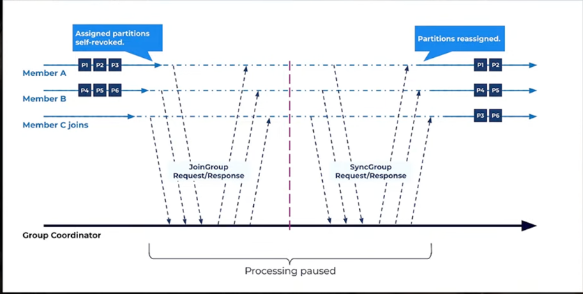
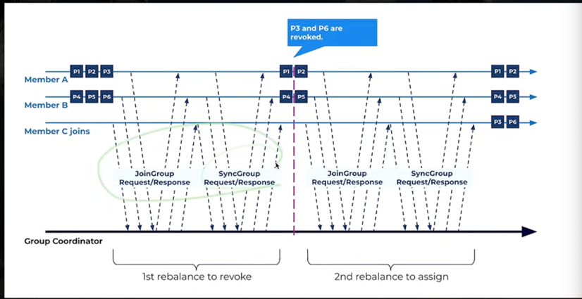
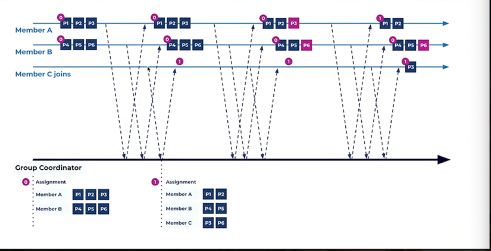
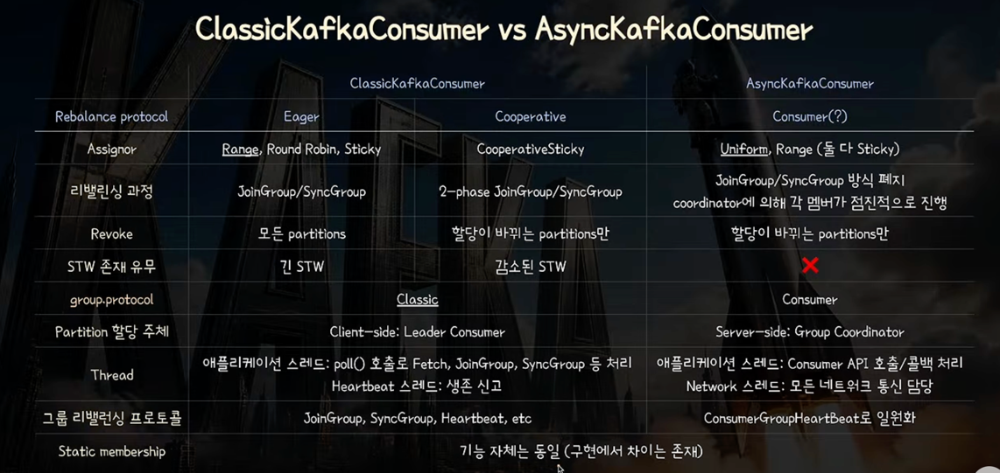
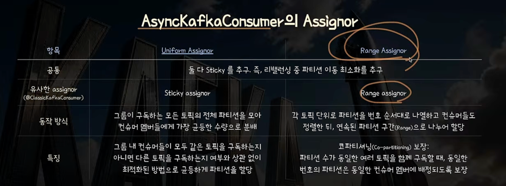
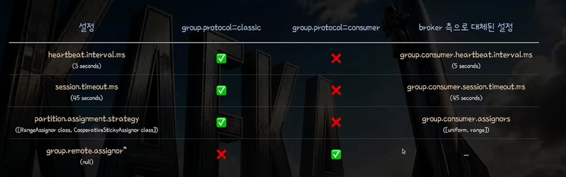
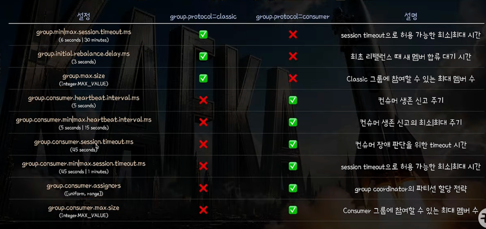

# Async Consumer

## Classic : Eager 방식

- Broker 쪽에 Group Coordinator, Member A, B 존재
- JoinGroup
  - 기존에 동작하던 Member들이 모두 JoinGroup으로 합류할 때 응답이 내려감
  - 리더에게는 모든 멤버 정보, 각 멤버에게는 자기 정보만 반환
- SyncGroup
  - 리더가 리밸런싱된 결과를 Group Coordinator에게 전달하기 까지 대기
  - 리더 결과를 받는 순간 나머지 멤버도 SyncGroup 응답을 보내줌

-> 실제로 재할당 대상은 소수이지만 모두 revoked 된다는 것이 단점

## Classic : Cooperative 방식

- 1차 Join & SyncGroup -> Rebalancing & Revoked
  - 같은 논리로 그룹 참여 기다림 -> Leader에 참여자 전달 -> Leader가 리밸런싱 결과 선정
  - SyncGroup에서 이동해야하는 파티션들(P3, P6)에 대해서는 어디로 이동해야하는지 아직 정보를 주지 않음
    - Group Coordinator - [P1, P2] 보존 -> MemberA 
    - Group Coordinator - [P4, P5] 보존 -> MemberB
  - MemberA, MemberB가 없는 파티션을 인식하고 P3, P6를 Revoked -> 이걸 위해 바로 정보를 MemberC에게 넘기지 않음
  - 즉, 유지해야하는 파티션 정보들만 포함해서 정보를 내려줌

- 2차 Join & SyncGroup -> Revoked된 파티션 할당
  - JoinGroup으로 Revoked되었는지 인식
  - 아예 Revoked된 대상이 없는 Member는 2차 Join 자체를 하지 않음 -> 바로 비즈니스 로직 수행함(v2.5.0부터)
  - SyncGroup에 이제는 새로 할당된 것 포함해서 편성 결과 전달

- 똑같이 STW가 있는 것은 맞음 but, revoked 대상이 줄음 -> 기존에 가지고 있는 메타데이터 재활용 가능

## Classic Kafka Consumer의 단점
- poll 동안에는 STW가 있을 수 밖에 없음
- 마지막 Consumer가 합류할 때까지 대기 -> Sync 응답 또한 Leader 응답이 있어야 가능

## Async Kafka Consumer

- 요청에 바로 응답을 보냄
- 네트워크 스레드가 비동기로 Consumer <-> Group Coordinator 소통 담당
- Group Coordinator가 할당 정보의 epoch를 보냄
- 1. 새로운 Member Join 시 Group Coordinator가 새로운 할당 진행하여 assign epoch +1
- 2. Revoked 대상 파티션이 포함되어 있는 MemberA에 할당 정보 보냄
- 3. MemberA가 P3 -> Revoke , MemberB는 아직 Revoke 안됨
- 4. 다음 HeartBeat에서 Broker가 MemberA에서 P3 Revoked되었음 인식
- 5. MemberC HeartBeat에 정상 Revoked 확인된 파티션 이전

-> 이런식으로 비동기적으로 & 점진적으로 Revoke -> Rebalancing 진행
-> 더이상 Consumer에 STW가 없음

## Classic vs Async

## AsyncKafkaConsumer의 Assignor - Uniform, Range

- 코파티셔닝이 필요한 상황 : 여러 Topic Record를 Join해서 처리하는 경우
- 코 파티셔닝이 되기 위한 조건
  - 파티션 수 동일
  - 동일 파티셔너 사용
  - 동일 레코드 키로 저장

## 타입에 따라 적용 가능한 Consumer 설정들
- classic -> consumer로 인해 broker 쪽으로 넘어간 설정도 있음

- 만약 AsyncConsumer의 group.remote.assignor 설정이 안되어 있으면 -> Broker측 group.consumer.assignors 설정(uniform | range) 사용됨

## 타입에 따라 적용가능한 Broker 설정들

- group.consumer.*는 새로운 Kafka Consumer 기준으로 설정된 값

