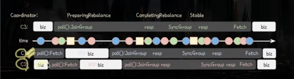
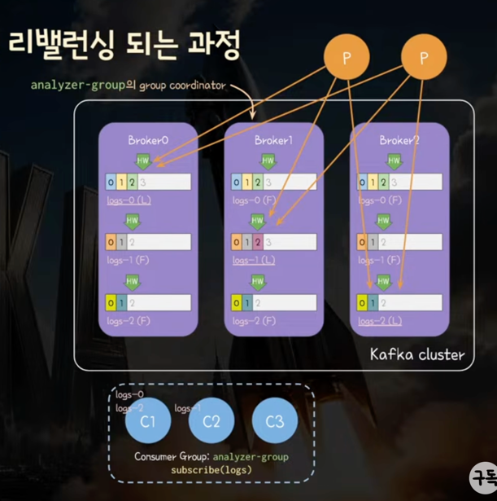
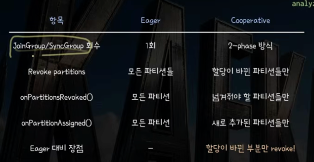

# Classic Consumer - Rebalancing 심화

### 요약본

## 현재 상황
- Broker1이 consumer group의 group coordinator(heartbeat 통신 담당)
- consumer.poll()로 요청 읽어옴
  - 할당된 partition 들이 있는 브로커로 FetchRequest를 보내어 레코드 읽는 코드가 내부에 있음
- C1이 파티션 0,2 담당, C2가 파티션 1 담당 -> C3 추가되어 리밸런싱 필요한 상황

### step1. 1차 JoinGroup을 통한 member_id 발급
  - 합류 후, 새로운 consumer는 아직 member id가 없음
    - 1. C3 -> group coordinator : 1차 Join Group 요청 in poll
    - 2. C3 <- group coordinator : MEMBER_ID_REQUIRED 에러 반환 새 member_id도 같이 반환

### step2. 2차 JoinGroup -> consumer 그룹 상태를 PreparingBalancing으로 변경
  - C3 -> group coordinator : 2차 Join Group with member_id
  - group coordinator가 consumer group state를 Stable -> Preparing Rebalance로 변경
  - 바로 2차 요청을 응답하는 것이 아니라 대기 큐에 대기시킴

### step3. poll을 통해 그룹 내 리밸런싱 감지 -> revoke -> 참여 요청
  - 백그라운드 Hearbeat Thread에서 HeartBeat 요청을 3초에 한번씩 보냄
  - group coordinator는 응답에 `REBALANCE_IN_PROGRESS` 에러 반환
  - C1이 비즈니스 로직 다 처리하고 다시 poll() 호출
  - poll() 내부에서 리밸런싱이 필요한 것 인지
  - EAGER 기준으로 할당 받았던 모든 partition들을 revoke(Cooperative는 다르게 동작)
    - ConsumerRebalanceListener.onPartitionsRevoked() 콜백 호출
  - C1,C2 -> group coordinator : Join Group 요청 with 이미 할당받았던 member_id 포함해서 요청

### group coordinator는 JoinGroup 요청을 언제까지 기다리나? -> 소비자들의 polling 최대 주기
- 최대 max.poll.interval.ms만큼 기다림
  - KafkaConsumer 내부 코드를 보면 기다리는 시간은 rebalanceTimeoutMs로 관리됨
- Consumer들의 max.poll.interval.ms 시간이 다르면 가장 큰 max.poll.interval.ms 시간만큼 기다림
- coordinator는 기존 consumer들을 기다림 
- -> 기존 멤버들을 기다리는 동안 JoinGroup으로 합류하는 신규 컨슈머들은 리밸런싱에 함께 포함됨

### step4. 기존 그룹 멤버의 JoinGroup이 다 모이면 -> 컨슈머들에게 JoinGroup 응답 전송
- 기존 멤버들이 모두 JoinGroup / rebalance timeout 경과 시 -> 이때까지 모든 컨슈머들이 리밸런싱 대상이 됨
- 상태 변경 : Rebalance -> CompletingRebalance
- coordinator는 대기 큐에 있던 JoinGroup 요청들에게 응답을 내려줌
  - leader consumer인지 follwer consumer인지에 따라 응답이 다름
  - 공통 : 자신의 메타데이터(generation id, protocol, leader의 member id, 자신의 member id)_
  - 차이 : leader는 그룹 내 모든 consumer들의 메타데이터(member id, metadata)를 받음
    - leader consumer가 토픽-파티션을 어떻게 할당할지 결정하기 때문

### 리더는 언제 결정되나?
- JoinGroup 요청 단계가 마무리된 직후에 결정
- 최초 리밸런싱/리더 이탈 시 : 가장 먼저 JoinGroup을 보낸 consumer가 리더가 됨
- 이미 리더가 있다면 -> 해당 리더 유지

### step5. 클라이언트 주도의 파티션 할당
- 리더는 JoinGroup response의 protocol에 명시된 방식으로 파티션 할당
- consumer는 partition.assignment.strategy 설정값을 리스트로 보유 : default [RangeAssignor class, CooperativeStickyAssignor class]
- JoinGroup 보낼 때 protocols 필드에 값을 담아 보냄 -> 공통 교집합 Strategy로 결정해 Leader에게 보냄

### step6. 모든 Consumer들이 SyncGroup 요청
- 리밸런싱에 참여 중인 모든 컨슈머는 coordinator로 SyncGroup 요청 전송
  - 팔로워 : JoinGroup response -> SyncGroup 요청
  - 리더 : JoinGroup response -> 파티션 할당 -> SyncGroup with 리밸런싱 결과
- Group Coordinator가 최대 max.poll.interval.ms만큼 리더 SyncGroup 응답 대기
  - 할당 정보 확인 후 __consumer_offsets 영속화
  - 그룹 상태 : CompletingRebalance -> Stable

### step7. SyncGroup 응답 : consumer에게 할당된 파티션 정보 전달
- SyncGroup 응답에 할당 파티션 정보 포함
- 리더 SyncGroup 도착 전 : 리더 응답 대기
- 리더 SyncGroup 도착 후 : 리밸런싱 결과 기반 바로 응답

### step8. SyncGroup 응답 처리
- ConsumerRebalanceListener.onPartitionsAssigned() 콜백 호출
- OffsetFetch : 할당 파티션들의 커밋된 offset 정보를 알기 위해 group coordinator로 OffsetFetch dycjd wjsthd
- Fetch: 할당된 파티션들의 리더 레플리카가 있는 브로커들에 요청을 보내 commit된 offset부터 레코드 fetch

---

## Eager 방식의 문제점

1) 비즈니스 로직 중단 시점 발생 : poll()에서 JoinGroup - SyncGroup 간의
2) consumer 요청이 하나라도 늦어지면 모두가 기다림
-> Cooperatvie를 써도 본질적으로 모든 Consumer Join -> Sync 로직으로 인해 같은 문제 경
3) Revoke가 필수라 리밸런싱 전후로 큰 차이가 없어도 OffsetFetch, 포지션 조정 메타데이터 업데이트 등등 불필요한 작업 수행
-> 이 문제를 Cooperative에서 해결

---

## Cooperative와의 차이점(2Phas)

### step1. 첫번째 Join-SyncGroup -> Sync에 변동사안 담아 1차 응답 -> 선택적 Revoke
- 파티션 할당만 재조정하여 각 컨슈머에 할당한 파티션 전달
- 이동해야할 파티션들은 SyncGroup에 내려주지 않음 -> 현재 내가 맡았지만 SyncGroup 응답에 포함되지 않은 것만 revoke
- 할당이 바뀌지 않은 파티션들은 계속해서 컨슘 및 로직 처리 / revoke된 파티션만 컨슘 중단

### step2. 두번째 Join-Sync -> 새로 추가된 파티션 추가 작업
- 할당이 바뀐 파티션까지 포함해서 SyncGroup 응답 때 내려줌
- consumer는 새로추가된 파티션만 추려서 추가 작업함
