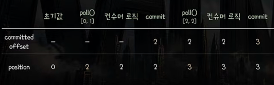
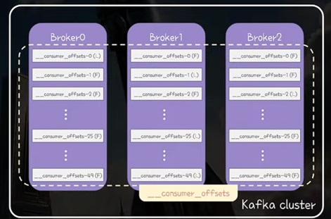
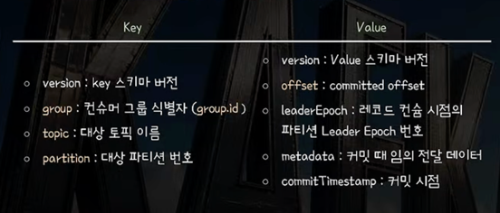
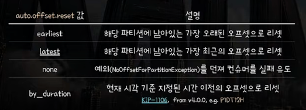
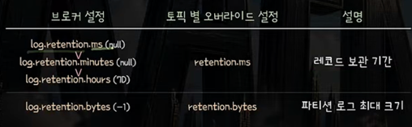
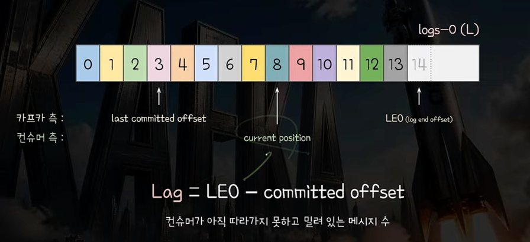

# 11부. Offset Commit

## 배경
- Offset Fetch : 컨슈머가 파티션의 몇번째부터 읽어야 하는지 그룹 코디네이터에게 받아오는 과정
- Fetch : 파티션에 저장된 실제 레코드를 오프셋 기준으로 fetch
- poll() : consumer api가 제공하는 메서드 -> 카프카로부터 받아온 레코드 반환

## Fetch & Fetch Buffer
- Consumer는 여러 레코드를 한번에 Fetch해서 내부 Fetch Buffer에 저장 -> I/O와 처리효율 높이기 위해
  - fetch.min.bytes(1byte): Fetch 응답 최소 크기 -> 브로커가 이 배치 사이즈를 채울때까지 기다림
  - fetch.max.bytes(약 50MB) : Fetch 응답 최대 크기
  - max.partition.fetch.bytes(약 1MB) : Fetch 응답에서 각 파티션 하나당 최대 바이트 크기
  - fetch.max.wait.ms(500ms): Fetch 시 최대 응답 대기 시간 -> 이 응답 시간때까지 min 값안차도 가져옴

- Fetch가 트리거되는 시점
  - Classic : '애플리케이션 스레드'가 poll() 호출 시 내부적으로 Java NIO Selector를 통해 
  - Async : '백그라운드 스레드'가 비동기로 Java NIO Selector를 통해

## poll() & Fetch Buffer
- poll() 호출 시 **Fetch Buffer의 모든 레코드를 한번에 다 반환 안함** -> Buffer에 많이 쌓아두고 야금야금 처리
  - 설정 값에 따라 버퍼된 레코드 일부만 반환
  - **max.poll.records(500)** : 한번의 poll() 호출 때 반환되는 최대 레코드 수
  - 너무 많은 레코드 반환 시 max.poll.interval.ms 내에 처리 못하면 -> 컨슈머에 문제 생겼다고 오판할 수 있기 때문

**- 비정상 판단 시간(max.poll.interval.ms)보다 처리시간이 길면, 그냥 판정 시간을 늘리면 되지 않나?**
  - 실무에서는 처리 단위인 max.poll.records를 먼저 조정하는 걸 가이드
  - max.poll.interval.ms는 비즈니스 로직 수행중이던 컨슈머에 문제가 생겼는지 감지하는 용도이기 때문
    - 너무 짧으면 장애가 아닌데 장애로 오판
    - 너무 길면 장애를 늦게 감지

## Consumer는 무엇을 Commit 하는가?
- commit: 토픽, 파티션 단위로 consumer가 어느 offset까지 안전하게 처리했는지 -> 기본적으로 카프카 내부에 기록
  
- commited offset(Kafka Cluster 관점) : poll()을 통해 반환된 레코드들 중에 (가장 큰 offset + 1)을 commit ex) 8까지 처리했으면 9를 커밋
  - 즉, 다음에 잉어서 컨슘해야할 오프셋 위치를 커밋
  - commited position이라고도 부름
  **- cumulative commit : commited offset 이전의 모든 레코드들은 안전하게 처리되었다고 볼 수 있음**
    -> DDB Stream처럼 단건에 대한 처리가 아니라 3을 커밋하면 0,1,2는 안정적으로 처리되었음을 확신할 수 있음
  
- position(Consumer 내부에서 관리되는 값): poll()을 통해 반환된 레코드들 중에 가장 큰 offset + 1
  - 컨슈머 내부에서 사용되는 변수로 poll() 호출 시 갱신됨
  - **Fetch 요청을 보낼 때 현재 position 값을 전달해 해당 위치부터 컨슘**
  - 컨슈머는 커밋하지 않아도 이어서 컨슘 가능! -> commited offset은 초기로드에만 보고 position으로 Fetch하기 때문에

## commited offset vs position
- commited offset은 Broker 내부에서 관리되는 단일 진실값
- position은 consumer가 자체적으로 관리하는 Fetch의 기준

## offset commit이 왜 중요한가?
- 컨슈머 그룹 리밸런싱 -> 파티션에 대해 처음 로드 시 어디서부터 파티션을 소비해야할지 모름
- 따라서 Group Coordinator가 내부 토픽에 주기적으로 해당 topic-partition을 키로 기록

## commited offset은 어디에 저장되는가?
- 카프카 내부의 __consumer__offsets 토픽의 특정 파티션에
  
- 동일 컨슈머 그룹은 동일 파티션에 commited offset이 기록됨
  - Math.abs(grouId.hasCode()) % offsets.topic.num.partitions(50)
  - 이렇게 계산된 파티션의 리더 레플리카가 있는 브로커는 해당 그룹의 group coordinator가 됨
  
- 컨슈머 그룹마다 담당 group coordinator 브로커가 저장
  - consumer가 group coordinator에게 offset commit 요청을 보냄
  - coordinator는 __consumer_offsets 토픽의 특정 파티션에 기록
  - commited_offset이 모든 ISR에 다 복제된 후에 응답을 내려줌

ex) 
- offsets.topic.num.partitions = 50, analyzer-group.hasCode() = 201
  - Math.abs(201%50) -> 1번 파티션
  - 
  - 1번 파티션의 Leader가 있는 Broker1이 Group Coordinator가 됨

- 관련 브로커 설정
  - offsets.commit.timeout.ms(5sec): offset commit timeout
  - offsets.topic.replication.factor(3) : __consumer_offsets 토픽의 replication factor

## Commited Offset은 어떤 형태로 저장되는가?

- 내부적으로 저장할 때 로그 컴팩션(Log Compaction)으로 관리
  - 가장 마지막에 커밋된 최신 레코드 1개만 남기고 과거 레코드는 정리
  - 즉 가장 최신의 group-partition : commit 최신값만 유지

## Commited offset이 없는 경우
- 커밋기록이 없는 상황
  - 상황1) 컨슈머 그룹이 최초로 대상 파티션 consume을 시작했을 때
  - 상황2) 파티션이 추가가 되었을 때
  - 상황3) 보관기간이 지나 카프카에서 commited offset이 삭제된 경우
    - offsets.retention.minutes
    - 컨슈머 그룹이 더이상 토픽을 구독하지 않을 때
    - 컨슈머 그룹이 비게 되었을 때 
- auto.offset.reset에 따라 동작

## commited offset이 가리키는 레코드가 없으면?
- 없을 수 있는 경우
  - 오프셋 보관기간보다 레코드 보관기간이 짧을 때
  - 파티션 로그에 너무 많이 쌓여 오래된 레코드 삭제
    - 프로듀서는 레코드 생산 중인데 컨슈머 그룹 중단 상태라면 -> 너무 많은 레코드가 쌓여 commited offset이 가리키는 레코드도 삭제가능

- 레코드 보관 관련 설정
  - 각각 ms -> minutes -> hours 순으로 설정이 적용됨
  - 

## Consumer Lag

- Lag : LEO - commited offset
- 컨슈머가 아직 따라가지 못하고 밀려 있는 메시지 수
- 어떤 라이브러리는 브로커 기준 commit offset이 아니라 position을 기준으로 표현하기도 함
- LAG가 0에 근점 -> 신속하게 잘 처리
- 일정 수준에서 등락을 반복 : 트래픽이 몰린 상황이지만 컨슈머가 제몫을 해주어 지켜봄
- Lag가 계속 증가함 : Produceer 생산 속도를 Consumer의 처리 속도가 따라잡지 못함
- 해결 방법
  - 컨슈머 수 증량
  - 파티션 수 증량
  - 처리 로직 개선
  - 잦은 리밸런싱 점검
  - 컨슈머 <-> Kafka Cluster 간의 네트워크 점검

## Offset Fetch : 최초 한번 커밋 지점 로드를 위해 그룹 코디네이터에게 질의하는 것
- consumer를 새로 할당 받은 후 처음 컨슘할 때만 offset fetch를 group coordinator에게 요청
- group coordinator가 준 commited offset 기준으로 position에 저장
