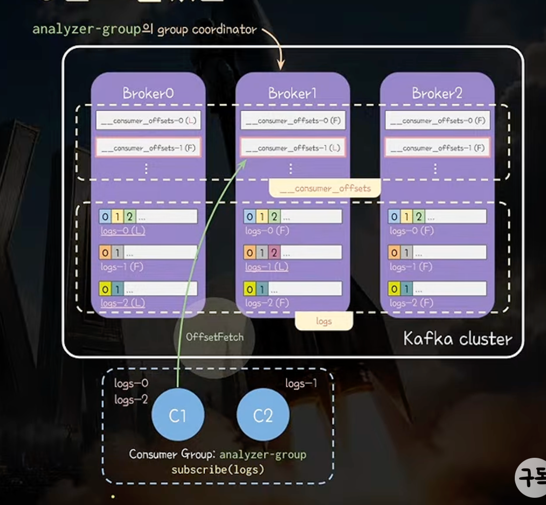
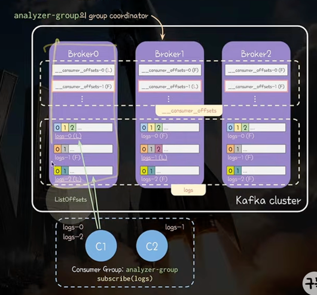
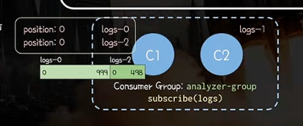
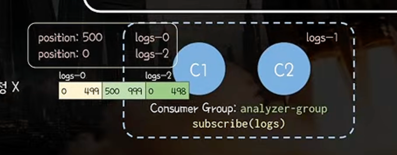
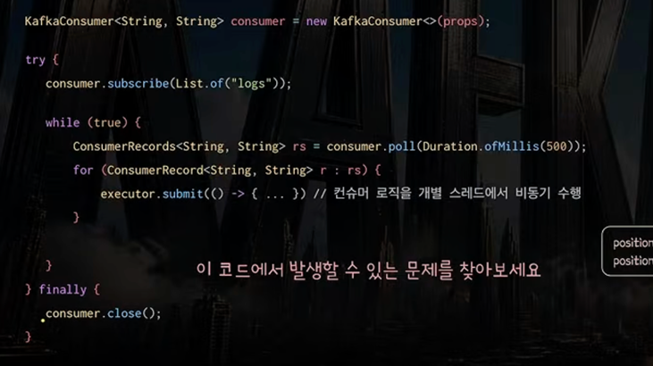
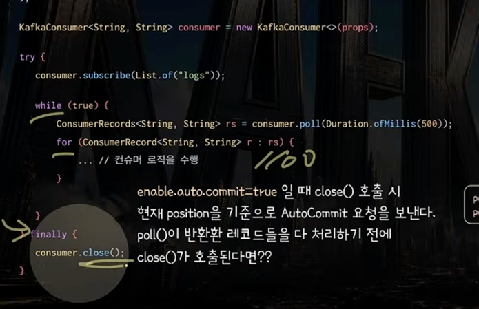

# 쉬운코딩 12부 : auto commit 동작 방식

## 자동 커밋 : enable.auto.commit=true
- poll의 내부 후름 정리
  - 1. Group Join/Rebalance 처리 - 이때 파티션 할당 / revoke 시 모든 파티션 AutoCommit
    - revoke나 rebalance 없으면 넘어감
  - 2. AutoCommit : 일정 간격 이상이면 직전 poll까지 반환된 position 값을 커밋
    - max.poll.interval.ms(5s) -> 처리가 3초면 commit을 하지 않음, 시간이 지난 시간이 poll주기만큼 흐르면 현재 poll 값을 보냄
  - 3. 파티션별 position 정보가 있는지 확인 -> 만약 없는 파티션이 있으면
    - OffsetFetch : 'coordinator'에 commited offset 요청, position 갱신
    - 
    - ListOffsets(commited offset 없을 시) : 각 '브로커'에 offset 요청 -> earliest, latest 등 옵션에 따라 위치를 내려줌 -> position 갱신
    - 
  - 4. Fetch from FetchBuffer : 
    - fetch buffer에 데이터가 있으면 max.poll.records만큼 바로 읽음
    - 없으면 6)으로 이동
  - 5. 없으면 -> Fetch(offset=position) : 
    - fetch.min.bytes(1byte) : Fetch 응답 최소 크기
    - fetch.max.bytes(50MB) : Fetch 응답의 최대 크기
    - fetch.max.wait.ms(500ms) : Fetch 시 최대 응답 대기 시간
    - max.partiion.fetch.bytes(약 1MB) : Fetch 응답의 파티션 단위 최대 크기
  - 
  - 6. buffer에 있으면 -> Fetch from FetchBuffer:
    - max.poll.records(500)만큼 읽음
    - fetch 되는 양만큼 position을 갱신
  - 7. Fetch(offset=position) : 다음라운드 대비해서 브로커별로 FetchBuffer 확인해서 fetch 미리 전송
    - fetch Buffer에 있는 데이터들을 보고 Fetch 미리 보내놓음(Non-Blocking)
    - C1이 fetch할 브로커는 Broker0뿐인데 Broker0에서 읽어온 레코드들이 아직 FetchBuffer에 있어서 Fetch 요청을 하지 않음
    - HeartBeat나 backGround 스레드가 요청을 받아 FetchBuffer에 갱신
    - 
  - 8. Poll 종료
    - fetch 한 레코드들 반환
  

## 자동 커밋 - at-least-once 보장
- poll() 호출 이벤트가 AutoCommit을 트리거함 -> 이전에 반환하여 비즈니스 로직 처리 갱신된 Position 커밋
- 즉, 호출 스레드에서 동기적으로 poll을 처리한다면 임의의 레코드가 처리되지 않고 커밋될 일은 없음
- 몇가지 레코드 처리하다 죽어서 중간에 offset을 갱신하지 않아서 다른 컨슈머에서 중복 처리될 가능성은 있음

## 예외케이스

### Case1) 비즈니스 로직이 비동기로 처리되었을 때 -> 처리 보장 없이 현재 Position 기준
- 실제 비즈니스 코드 실제 성공여부가 보장이 안된상태로 커밋이 가능함 -> 비즈니스 코드는 동기 처리할 것 

### 에러나서 Close 호출 시 -> 현재 Position 기준

- enable.auto.commit=true 일때 -> close() 호출 시 > position기준으로 AutoCommit
- 즉, 비즈니스 코드 한창 처리 하고 있었는데 에러 나서 finnaly로 가면 현재 position 기준으로 commit 쳐버린다
  
### 실 서비스에서는 auto commit 비권장
- 주요 이유
  - 디테일한 커밋 컨트롤이 어려움
  - 커밋 실패에 대한 자체적인 대응 어려움
  - 처리되지 못하고 유실 가능성 존재 ex) 에러나서 현재 Position 기준으로 close 호출 
- 카프카 클라이언트로 제공되는 기본 컨슈머 -> auto.commit=true default
- Spring kafka v2.3부터 -> enalbe.auto.commit=false로 지정
