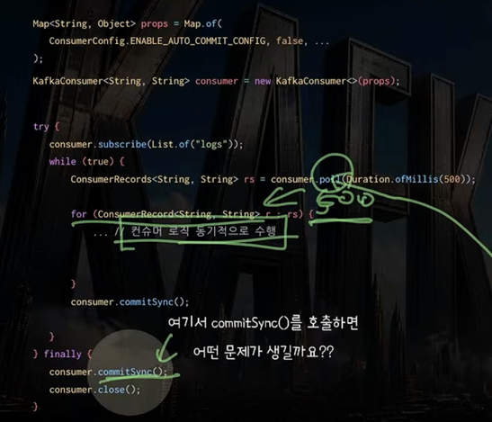
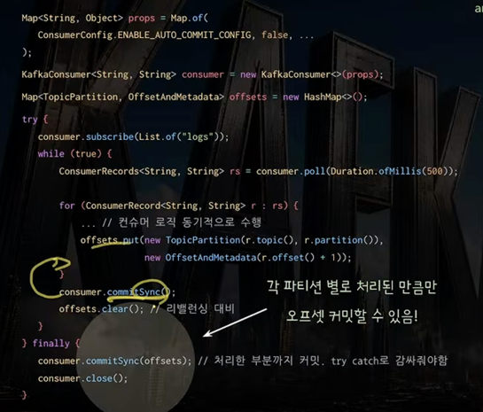
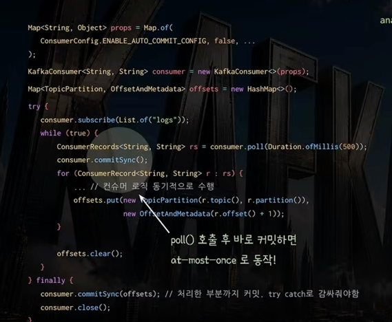
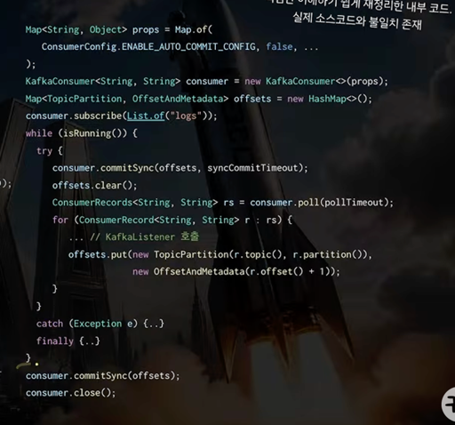
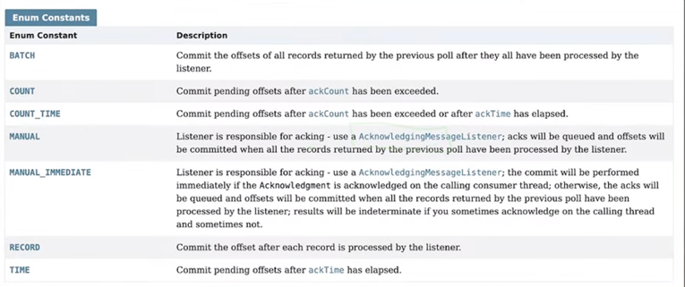

# 13. Manual Commit

- enable.auto.commit = false 일 때
  - commitSync
  - commitAsync
  
## CommitSync
- default.api.timeout.ms(1min) : 전체 응답시간
  - commitSync(Duration timeout)처럼 파라미터에 timeout이 있는 경우 timeout이 default.api.timeout.ms를 대체함
- request.timeout.ms(30sec) : 개별 요청 1회 응답 대기 시간
- retry.backoff.ms(100ms) : 재시도 사이 대기 시간

### Quiz
- catch에서 commitSync를 하면 나오면 문제점 -> 중간에서 에러가 났을 때 position 값 기준으로 update가 되어서 유실 발생 가능

### 방식1. 하나의 Batch 단위가 끝날 때마다 Commit 하기

-> 하나의 레코드마다 커밋은? : Sync 호출로 인해 병목 생길 수 있음

### 방식2. at-most-once로 동작하게 하려면?
- 배치를 처리하기 전에 바로 commit 나게 됨 but, 유실을 허용하게 됨

## Spring Kafka v4.1

- 직전 라운드에서 처리된 레코드에 대해서만 position 커밋
- clear는 리밸런싱 목적

## commitAsync
- commitAsync(OffsetCommitCallBack callback)
- non-blocking 방식으로 position에 기록된 값을 커밋
- 네트워크로 전달된 요청이 에러 발생 시 callback으로 exception 던지거나 callback이 없으면 버려짐
- 호출순으로 요청이 전달되고 콜백도 마찬가지, 실패해도 재시도하지 않음
  - 비동기 커밋을 재시도하게 되면 커밋 순서가 꼬인 상태로 정보를 덮어쓸 수 있음
  - 만약 실패했다고 하더라도 다음 라운드에서 커밋에 성공하면 이전 실패분까지 커밋되는 효과 -> cumulative commit이므로

## Spring-Kafka : ackMode
- 디테일하게 커밋 타이밍을 잡아갈 수 있음

