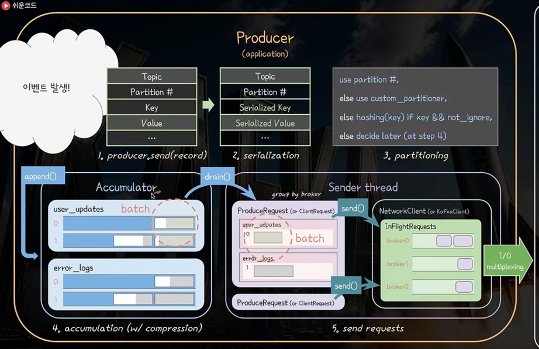
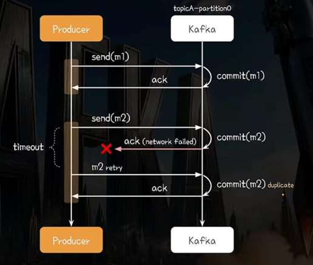
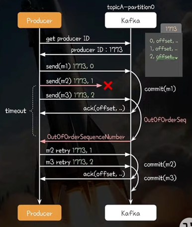
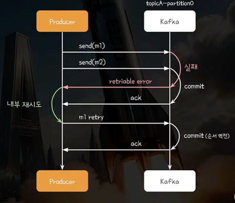

# 15부. 멱등 프로듀서

## Producer 복습
- Serialize > Partitioning > Accumulating(Topic-Partition 그룹핑) > InflightClient(브로커별 그룹핑)

## Producer의 레코드 중복 생성 시나리오

- 1. Producer가 m1 send -> Kafka Cluster가 commit하고 ack 응답
- 2. Producer가 m2 send -> Kafka Cluseter가 복제 확인 후 commit 하고 ack 응답
- 3. ack가 네트워크 이슈로 유실
- 4. Produceer가 m2를 한번 더 send retry <- 중복 발행!

## Idempotent producer
- Producer가 내부적으로 retry하는 경우 -> 중복기록되지 않도록 동작하는 producer
- Kafka 3.0부터 Idempotent Producer가 default
- enable.idempotence = true
  - 명시적으로 설정할 경우 -> 다른 조건 만족 못했을 때 ConfigException
  - 명시적으로 설정 안하고 암묵적 설정에 기댈 때 : 다른 설정들이 충돌하면 producer가 idempotent로 동작X
- acks = all(-1)
- retires(MAX_INT) > 0
- max.in.flight.requests.per.connection(5): 5이하 자연수

## Idempotent producer는 중복 producing을 어떻게 막는가?
- 레코드 단위가 아닌 실제로는 Batch 단위로 동작
- producerID X sequenceNumber -> 중복 판정 + 순서대로 도착했는지 판정
  
- 만약 순서가 꼬여서 도착한 경우 -> OutOfOrderSequenceNumber 에러 반환
  - 

- 중복 전송인 경우 -> 파티션에 쓰지 않고 캐싱된 정보 반환
- 동작원리
  - 최초의 브로커가 Producer 각각에게 id 발급
  - producer -> (producerID X sequence number)-> 브로커
  - sequence number는 레코드마다 파티션 단위로 1씩 순차 증가
  - 브로커는 파티션 단위로 producerId와 sequence number를 관리

## enable.idempotence = false일 때의 주의사항
- retires >0/ max.in.flight.requests.per.connection >1 이면 순서가 역전되어서 저장될 수 있음
- 내부적으로 재시도하는 경우 중복없이 + 순서보장하려면 idempotent producer 사용 필요

## Idempotent producer의 한계와 의의
- idempotent producer가 보장하는 멱등성의 범위
  - 같은 producer내의 재시도 -> producerId X sequenceNumber이므로 

- 보장하지 못하는 멱등성 상황
  - 리밸런싱을 통해 재시도되는 경우
  - producer가 재시작하여 다른 producerId를 지니게 되었을 때
  - producer.send(m) 자체가 최종적으로 실패한 후에 다시 호출된 producer.send(m)
    - producer.send 단위로 호출되는 레코드는 동일하지 않은 별개 레코드로 인지

- 결국 모든 중복을 완전히 피할 수 없으므로 consumer의 멱등성 보장이 필요

